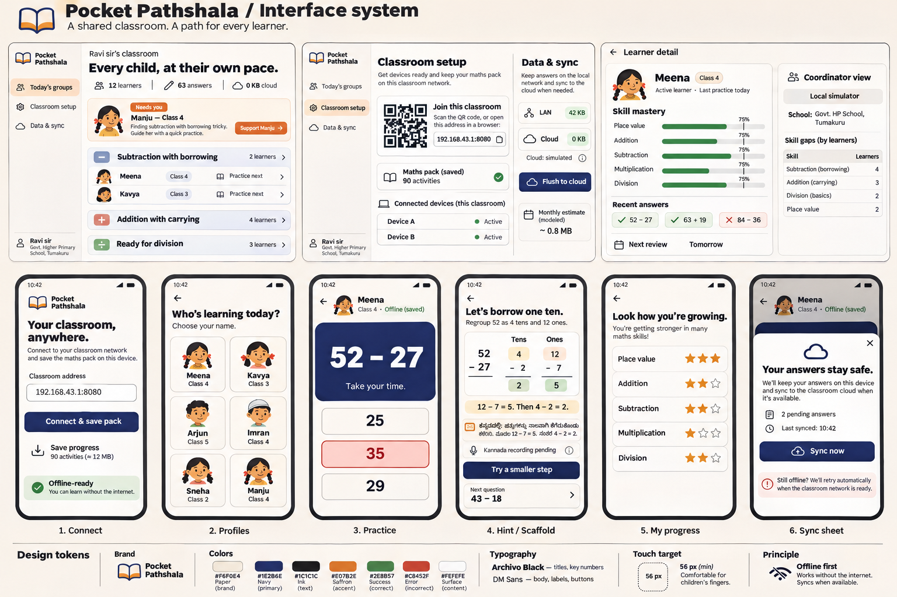
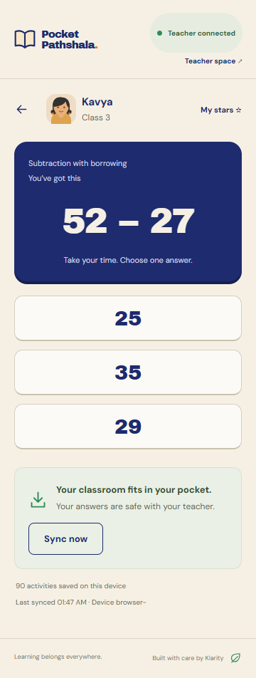
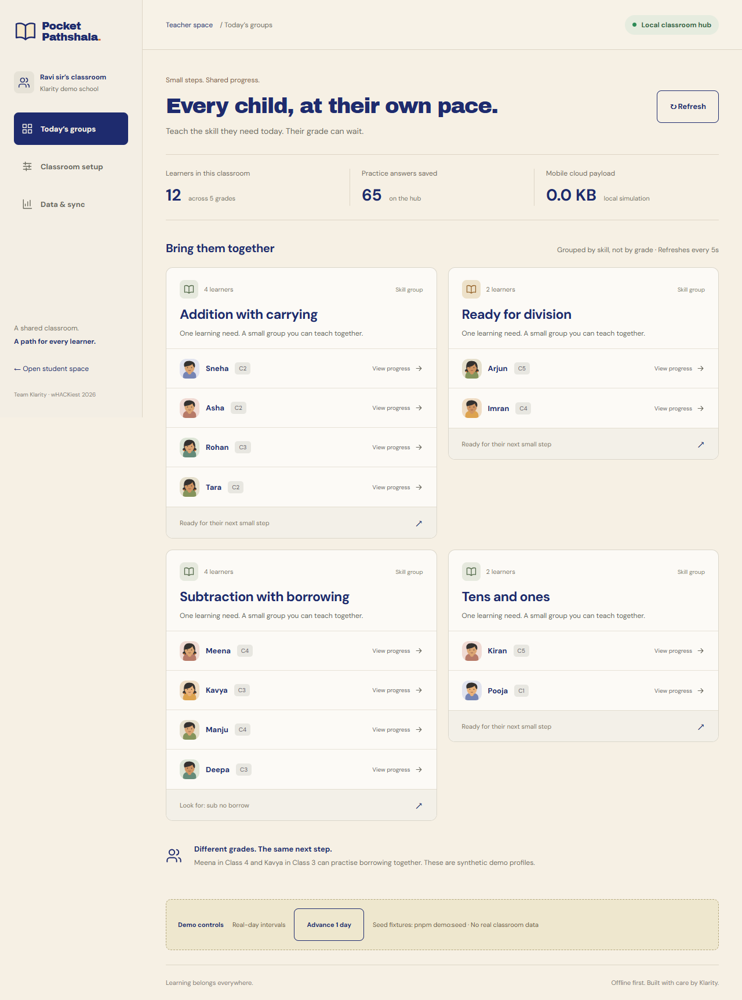

# Pocket Pathshala

> A pocket-sized, offline-first maths classroom that helps one teacher support every learner — even when the internet disappears.

[](https://www.typescriptlang.org/)
[](docs/16-verification.md)
[](docs/02-architecture.md)
[](LICENSE)

<p align="center">
  
</p>

## The idea

**Pocket Pathshala** is an adaptive learning companion for low-connectivity classrooms. A student can practise maths on a shared Android phone while the local classroom hub records progress, surfaces misconceptions, and gives the teacher a calm, actionable view of the room.

It is designed around a simple belief: a weak or missing connection should never interrupt a child’s learning. The student experience remains local and responsive; syncing is opportunistic, compact, and visible.

| Learner experience | Teacher experience |
| --- | --- |
| Large, low-friction maths practice designed for a shared phone | A live classroom view grouped by the misconception to address next |
| Adaptive review using a lightweight BKT learning model | Individual learner history, sync status, and next-step guidance |
| Kannada hint copy and visibly labeled audio support | A laptop-hosted local hub for a trusted classroom LAN |
| IndexedDB persistence and an offline-ready web shell | Optional queued upload to the local cloud simulator |

## Built for real classroom constraints

- **Offline by default.** Learner events are written locally first; no active internet connection is required to practise.
- **One device, many learners.** Device-scoped local stores make a shared phone practical for classroom rotation.
- **Adaptive, explainable practice.** Deterministic BKT updates, prerequisite replay, targeted hints, and a transparent next-question selection flow.
- **Teacher signal over teacher noise.** Grouped misconceptions help the teacher see who needs the same intervention.
- **Content that travels well.** A validated maths pack ships 90 Grade 2–5 MCQ items, Kannada hints, and lightweight SVG assets.
- **Privacy-minded prototype.** The demo uses synthetic seed data and is intended for a trusted LAN — never a public deployment or real children’s identifying data.

## Product tour

<p align="center">
  
  &nbsp;&nbsp;&nbsp;
  
</p>

1. A learner chooses their profile and completes a short maths prompt.
2. A wrong answer opens the appropriate Kannada-friendly scaffold and a prerequisite question.
3. The local hub records the event and recomputes mastery.
4. The teacher sees learners clustered by a shared skill gap, not buried in raw data.

## Quick start

**Requirements:** Node.js 22.13+ and pnpm 11.20+.

```powershell
pnpm install
pnpm build
pnpm demo:seed
$env:DEMO='1'
pnpm dev
```

Open these three views:

- [Student A](http://localhost:8080/?device=A)
- [Student B](http://localhost:8080/?device=B)
- [Teacher dashboard](http://localhost:8080/teacher?demo=1)

For the guided demo, choose **Meena**, enter `35` for `52 − 27`, follow the borrowing hint, then enter `25` for `43 − 18`. Sync and inspect the borrowing group with Meena and Kavya. The seeded prerequisite history is synthetic and labeled as device `seed`.

To run the local cloud simulator in another terminal:

```powershell
pnpm dev:cloud
```

Then use **Teacher → Data & sync → Flush to cloud**. This sends real gzipped events to a local simulator at [localhost:8787/coordinator](http://localhost:8787/coordinator); it is not an AWS deployment.

## Architecture at a glance

```text
Shared Android phone / browser
  └─ React + Vite UI · IndexedDB · adaptive learning engine
       │ queued, idempotent event batches
       ▼
Classroom laptop hub
  └─ Fastify · SQLite · teacher dashboard · content distribution
       │ optional compressed upload
       ▼
Local cloud simulator
  └─ Fastify · SQLite · synthetic coordinator view
```

Read the [architecture](docs/02-architecture.md), [sync protocol](docs/04-sync-protocol.md), [learning engine](docs/05-learning-engine.md), and [content-pack guide](docs/06-content-packs.md) for the full design.

## Verify the build

```powershell
pnpm format:check
pnpm typecheck
pnpm lint
pnpm test
pnpm build
pnpm test:browser
```

The repository includes 23 unit tests and three isolated browser scenarios, covering adaptive replay, local persistence, hub APIs, cloud ingestion, offline reload, responsive layout, and teacher grouping. See [verification evidence](docs/16-verification.md).

Useful commands:

| Command | Purpose |
| --- | --- |
| `pnpm dev` | Serve the built app and local hub on port 8080 |
| `pnpm dev:app` | Run Vite with the local API proxy on port 5173 |
| `pnpm pack:build` | Regenerate and validate the content pack |
| `pnpm demo:simulate` | Send deterministic synthetic prerequisite attempts to a running hub |
| `pnpm demo:bytes` | Produce the shell and event-payload budget report |
| `pnpm hub:bundle` | Create a portable Node hub, web assets, and pack in `dist/termux` |

## Android build

The Capacitor Android project is included. To rebuild the debug APK:

```powershell
pnpm build
pnpm --filter @pp/app android:sync
Set-Location apps/app/android
.\gradlew.bat assembleDebug
```

The output is `apps/app/android/app/build/outputs/apk/debug/app-debug.apk`. Read the [Android and hotspot setup](docs/13-android-hotspot-setup.md) before a device demo.

## Honest limits of this prototype

- Kannada text hints are present; ten human-recorded Kannada audio clips are still needed and missing audio is visibly labeled.
- The web app uses IndexedDB; the hub and local cloud simulator use SQLite. Native student SQLite is deferred.
- Browser offline reload requires a service worker on localhost or HTTPS. Plain HTTP LAN browsing is not equivalent to an installed Android app.
- Android 9+ runtime, Termux, and real hotspot behaviour still need physical-device testing.
- The cloud path is simulated locally. Usage counters are modeled, not field evidence.
- The trusted-LAN prototype has no production authentication. Do not expose it publicly or enter real children’s identifying data.

## Project documentation

- [Product requirements](docs/01-prd.md) · [screen inventory](docs/07-ui-screens.md) · [API reference](docs/08-api.md)
- [Demo script](docs/09-demo-script.md) · [build plan](docs/10-build-plan.md) · [test strategy](docs/11-testing.md)
- [Pitch alignment](docs/12-pitch-alignment.md) · [pilot and impact plan](docs/14-pilot-and-impact.md) · [design direction](docs/15-design-direction.md)
- [Design board](docs/design/README.md) · [decision log](docs/DECISIONS.md)

## Team

Built by **Team Klarity** for **wHACKiest 2026 · UnlockED Track 4**.

Licensed under the [MIT License](LICENSE).
