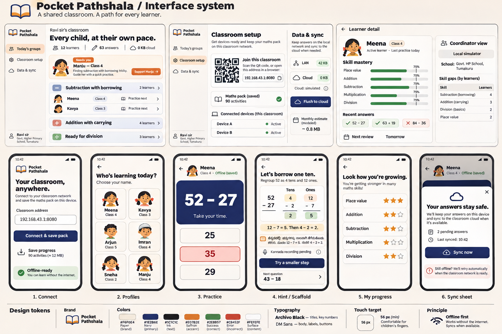

# Interface reference

Generated with the built-in image generator before the second implementation pass, per the user's image-first direction. The plugin search did not return an exact Visualise plugin. The design board covers teacher groups, setup/data, detail/coordinator and six student flow frames. The runtime implementation uses local SVGs and CSS; it does not download this image.

Critique and implementation choices: preserve restrained alignment, open-book identity, child portraits, navy arithmetic board, vertically stacked mobile choices, structured borrowing example, learner rows, and native dialog sheets. Remove the image's accidental gradients; keep flat brand colors. Replace illustrative numbers with measured/model-labeled runtime data. Do not copy malformed generated Kannada, invented schools, or the image's unverified pack-size figure. Real Kannada text remains pending educator review.

Acceptance: 360px layout, no horizontal overflow; ≥56px answer targets; keyboard and Escape support for dialogs; text and icons for correctness; full offline reload; no remote fonts or runtime imagery. See 15-design-direction.md for the screen inventory.
